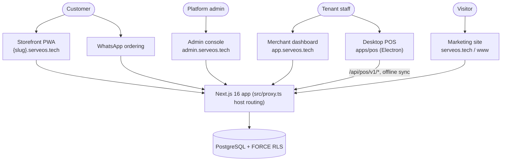

# ServeOS Documentation

ServeOS is a **multi-tenant commerce and operations platform** for small businesses, built for Egypt first (EGP pricing, Arabic-first marketing). Storefront orders, counter POS sales and WhatsApp orders are stored and processed as the same kind of order in one tenant-isolated Postgres database.

Each tenant runs one **vertical**:
- **Restaurant** — modifiers, recipes (ingredient deduction), service charge
- **Retail** — variants, finished-goods stock
- **Pharmacy** — variants, prescription upload and pharmacist review
- **Timber** — dimensional products (m / m² / board feet), cut-to-size stock with kerf, trade accounts

Fulfillment is pickup or delivery for all verticals.

## Surfaces

## Tech stack

- **Web:** Next.js 16 (App Router, Proxy), React 19, Tailwind CSS v4, Radix UI, lucide-react, Recharts
- **Data:** PostgreSQL (Supabase) + Drizzle ORM, Row-Level Security per tenant
- **POS:** Electron + Vite + React, `better-sqlite3` offline event store
- **Integrations:** Resend (email), WhatsApp Cloud API, Supabase Storage + Realtime
- **Testing:** Vitest (DB-backed), Playwright
- **Ops:** Vercel (prod + QA projects), GitHub Actions (CI, deploy watch, backups to Cloudflare R2)

## Business model

Tenants subscribe; their customers use the storefront. Four plans, EGP per month (`src/server/subscription/plans.seed.ts`):

| Plan | Price | Branches | Staff | Products |
|---|---|---|---|---|
| Free (`basic`) | 0 | 1 | 2 | 50 |
| Starter (`pro`) | 499 | 3 | 10 | 500 |
| Growth (`growth`) | 699 | 5 | 25 | 2000 |
| Professional (`enterprise`) | 1099 | 50 | 200 | 100000 |

Billing is manual (payment proof, admin confirmation) behind the `BillingProvider` interface; no card payment gateway is integrated.

## Locked decisions (from [ROADMAP.md](./ROADMAP.md))

- **D1** hash-chained, fingerprinted, system-wide audit log — implemented
- **D2** reconciliation: daily close + cash drawer + external settlement — drawer/close implemented; settlement waits on D3
- **D3** Paymob-first payment gateway — **parked**
- **D4** recipe/BOM auto-deduction with FIFO lots — implemented
- **D5** full PO lifecycle — implemented
- **D6** cross-channel, dual-surface reporting — implemented
- **D7** Resend for email — implemented
- **D8** ETA e-invoicing & e-receipts (Spec 11) — **in scope, not implemented**
- **D9** recipe or finished-goods stock per product — implemented

## Documentation map

| Document | What it covers |
|---|---|
| [CONTEXT.md](../CONTEXT.md) | Domain glossary |
| [requirements/functional.md](./requirements/functional.md) | Verticals, modules, roles & permissions (generated matrices) |
| [requirements/non-functional.md](./requirements/non-functional.md) | Performance targets, security, concurrency, reliability, compliance status |
| [architecture/overview.md](./architecture/overview.md) | Context/containers, routing, modules, tenancy, POS, deployment |
| [flows/sequence-diagrams.md](./flows/sequence-diagrams.md) | 10 end-to-end flows |
| [flows/state-machines.md](./flows/state-machines.md) | Every status enum and its real transitions |
| [getting-started/onboarding.md](./getting-started/onboarding.md) | Where to start (setup lives in [NEW-LAPTOP-SETUP.md](./NEW-LAPTOP-SETUP.md)) |
| [getting-started/codebase-conventions.md](./getting-started/codebase-conventions.md) | Layout, modules, naming, patterns |
| [database/erd.md](./database/erd.md) | ERD (generated from foreign keys), tables by schema file |
| [database/tables.md](./database/tables.md) | Every table, column and enum (generated) |
| [api/README.md](./api/README.md) | Route catalog (66 route files, 81 handlers) and Server Actions (32 files, 84 actions), generated |
| [testing/testing-strategy-and-gaps.md](./testing/testing-strategy-and-gaps.md) | Test tiers, fixtures, CI, known gaps |
| [ROADMAP.md](./ROADMAP.md) | Spec sequencing and decisions |
| [prds/](./prds/) | PRDs (MASTER-PRD, PRD-002 cross-channel reporting, high-level product and ZATCA PRDs) |
| [references/](./references/) | Operational truth: environments, QA setup, backup/restore, realtime, providers |
| `docs/{ailab,superpowers,moai,adham-ai}/` | Per-agent design specs and plans; each feature's `*-design.md` is its spec of record |

Setup, environments, test users and the POS run loop are in the [root README](../README.md) and [NEW-LAPTOP-SETUP.md](./NEW-LAPTOP-SETUP.md).
