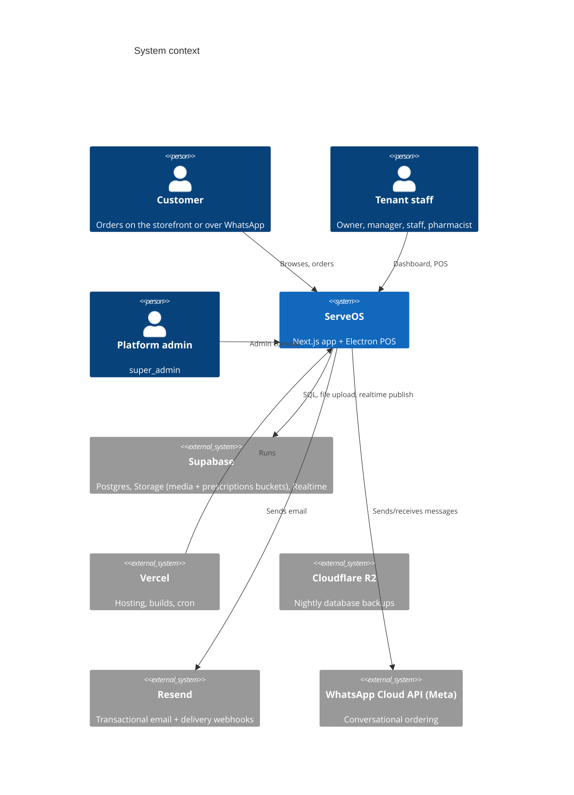
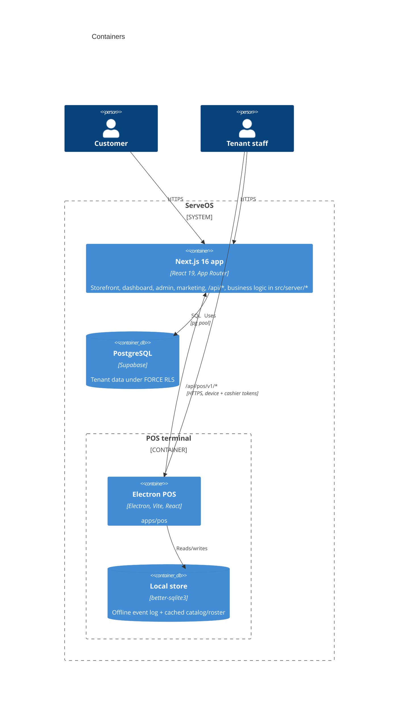
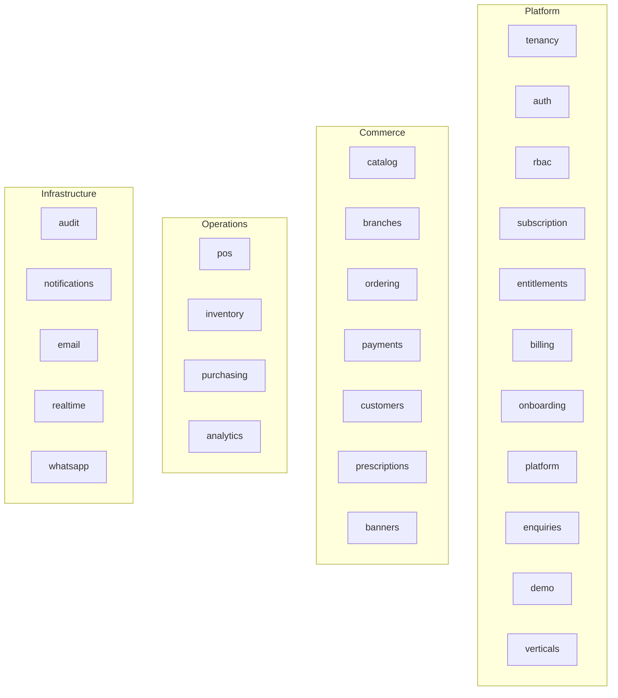
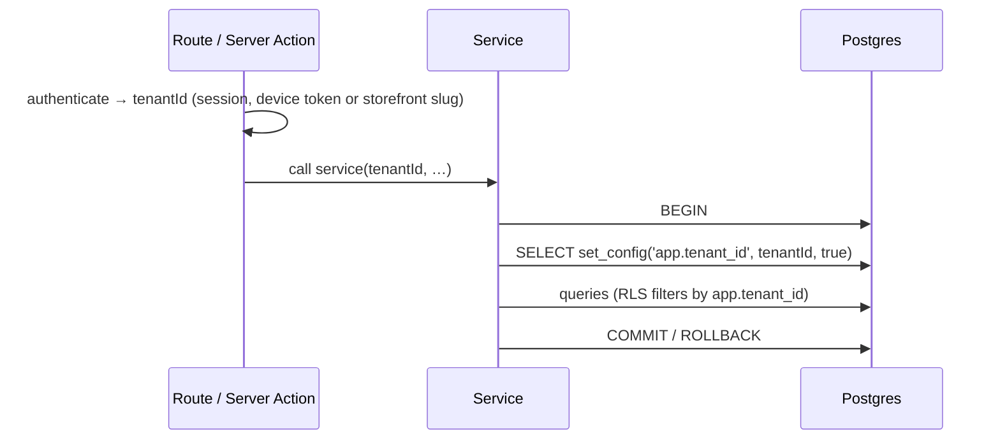

# Architecture Overview

ServeOS is one Next.js 16 application (all web surfaces) plus an Electron POS, backed by a single PostgreSQL database with Row-Level Security.

## 1. System context

Not integrated today: a card payment gateway (Paymob is the chosen first provider but Specs 6–7 are parked) and fiscal e-invoicing (ETA — Spec 11, ZATCA — PRD only). See [non-functional.md §5](../requirements/non-functional.md#5-compliance).

## 2. Containers

## 3. Host-based routing

`src/proxy.ts` — the Next.js 16 **Proxy** (the convention that replaced `middleware.ts`) — classifies the request host with `classifyHost` (`src/middleware-routing.ts`) and sets request headers the app reads:

| Host | `x-surface` | Surface |
|---|---|---|
| `app.<root>` | `dashboard` | Merchant dashboard (`/login`, `/register`, `/dashboard`) |
| `admin.<root>` | `admin` | Platform admin console (`/admin`) |
| `<root>`, `www.<root>` | `marketing` | Marketing site (bilingual; also sets `x-locale`) |
| `<slug>.<root>` | `storefront` | Tenant storefront (installable PWA); also sets `x-tenant-slug` |
| anything else | `marketing` | |

`<root>` is `ROOT_DOMAIN`: `serveos.tech` in production, `qa.serveos.tech` on QA, `serveos.localhost` locally (port 3000). The proxy strips any client-supplied `x-tenant-slug` / `x-locale`. The root `src/app/page.tsx` serves only storefronts (`x-surface = storefront`); the marketing site lives under `src/app/(marketing)/[lang]`, and the proxy rewrites the marketing host's `/` to `/ar`.

The fifth surface is the desktop POS (`apps/pos`), which talks only to `/api/pos/v1/*`.

## 4. Domain modules

Business logic lives in **27** modules under `src/server/`:

Fourteen modules expose an `index.ts` barrel (auth, banners, billing, branches, catalog, email, entitlements, onboarding, ordering, platform, rbac, subscription, tenancy, verticals); the other thirteen do not, and code across the repo imports module files directly (e.g. `@/server/pos/require-cashier`, `@/server/audit/service`). There is no enforced import boundary between modules.

Route handlers and Server Actions are thin: they authenticate, validate the body and call a service in `src/server/<module>/`.

## 5. Multi-tenancy

- 52 tenant tables carry `tenant_id` and have `ENABLE` + `FORCE ROW LEVEL SECURITY` with a policy on `app.tenant_id`.
- `withTenant(tenantId, tx => …)` (`src/db/with-tenant.ts`) opens a transaction and runs `SELECT set_config('app.tenant_id', $1, true)`; every query inside is filtered by RLS. Outside it, RLS tables return nothing.
- 20 control-plane tables (e.g. `tenants`, `users`, `sessions`, `plans`, `pos_devices`, `whatsapp_accounts`, `audit_logs`) have no RLS; server code reads them directly.
- RLS only binds a non-superuser role without `BYPASSRLS` — a superuser sees every tenant's rows. Production uses the `app` role (`NOBYPASSRLS`), CI's tests run as `serveos_ci` and local dev uses `serveos_app` (both `NOSUPERUSER NOBYPASSRLS`).

## 6. Verticals

`tenants.vertical` (`restaurant` | `retail` | `pharmacy` | `timber`) selects a descriptor in `src/server/verticals/registry.ts`: capability flags (`modifiers`, `variants`, `inventory`, `recipes`, `serviceCharge`, `dimensionalProducts`, `unitsOfMeasure`, `tradeAccounts`, `prescriptionUpload`, `pharmacistReview`, …), terminology (EN/AR), the storefront template (`menu` or `shop`) and checkout adjustments. Services call `requireCapability` / `getCapabilities` to gate behaviour. The full matrix is in [functional.md §2](../requirements/functional.md#2-verticals).

## 7. POS

- **Main process holds the secrets.** `apps/pos/electron/pos-main.ts` keeps the device and cashier tokens and makes every `/api/pos/v1/*` call; the React renderer reaches it through the `window.pos` context bridge (`preload.ts`).
- **Auth:** `Authorization: Bearer <deviceToken>` identifies the terminal; `X-POS-Cashier` identifies the signed-in human.
- **Offline-first:** a `better-sqlite3` store (`apps/pos/electron/_offline/`) records every action as an event and caches the catalog, pricing, shift policy and sign-in roster, so the till keeps selling without a network and replays events to `POST /api/pos/v1/sync/events` when it reconnects (shipped in #138).
- **Shared code:** money math (`src/lib/order-totals.ts`) is imported by both the server and the POS renderer (`@shared/order-totals`); drawer arithmetic lives in `src/server/pos/shift-math.ts`.

## 8. Data integrity

- **Hash-chained audit log:** `audit_events` rows carry `prev_hash` / `entry_hash` (SHA-256) per tenant; a trigger blocks UPDATE/DELETE.
- **Stock ledger:** `stock_ledger` is append-only by convention; lots (`inventory_lots.qty_remaining`) are a FIFO cache over it.
- **Idempotency:** `pos_order_receipts` (device + client order id), `pos_sync_event_receipts` (offline events) and `whatsapp_order_receipts` (conversation + confirm message) make retries and replays safe.
- **Advisory locks:** `pg_advisory_xact_lock(hashtext(tenant_id))` serializes order-number allocation and audit-chain appends per tenant (one key, one lock order).

## 9. Deployment

| Env | URL | Vercel project | Deploys on | Database |
|---|---|---|---|---|
| Production | `serveos.tech` / `www.serveos.tech` | `serve-os` | push to `main` | Supabase prod (aws-1 pooler) |
| QA | `qa.serveos.tech` | `serve-os-qa` | push to `qa` | Supabase `ServeOs-qa` (aws-0 pooler) |

- **Migrations run in the build:** `vercel-build` = `tsx scripts/release-migrate.ts && next build`. It migrates only when `VERCEL_ENV=production`, so a production deploy of either project **is** a migration of its database; a failed migration fails the build. Preview deployments skip it because they typically share the production database.
- **Promote main to QA:** `git push origin main:qa`. A push to `main` also creates a Preview deployment on `serve-os-qa` that does not serve `qa.serveos.tech` and does not migrate, so QA's schema lags main until `qa` is promoted; the nightly `demo-reset` workflow migrates QA (from `main`) before re-seeding the demo tenants.
- **Deploy watch:** `.github/workflows/deploy-watch.yml` turns a push that never deploys, never reaches READY or never serves its SHA into a red run.
- **Backups:** nightly `pg_dump` of prod and QA to Cloudflare R2 at 03:00 UTC (`db-backup.yml`), quarterly restore drill (`db-restore-drill.yml`). Runbook: [backup-restore.md](../references/backup-restore.md). Full infrastructure map: [environments.md](../references/environments.md).
