# Database Design & ERD

## 1. Overview

- **Engine & ORM:** PostgreSQL via Drizzle ORM. Table definitions live next to their domain code (`src/server/<domain>/schema.ts`, plus `*-schema.ts` / `*.schema.ts` files for POS, purchasing, payments and platform audit) and are re-exported by `src/db/schema.ts`, which `drizzle.config.ts` points at.
- **Size:** 72 tables and 36 enums in the latest snapshot. Column-level detail for every table is in [tables.md](./tables.md) (generated).
- **Migrations:** 46 SQL files in `drizzle/` (`0000_…` to `0045_…`), tracked by `drizzle/meta/_journal.json`.
- **Tenant isolation:** 52 tables have `ENABLE` + `FORCE ROW LEVEL SECURITY` with a `<table>_isolation` policy on `app.tenant_id`; the other 20 are control-plane/global tables without RLS. See [tables.md](./tables.md#how-tenancy-works-in-the-schema).

## 2. Core ERD

Generated from the foreign keys in the latest Drizzle snapshot, for a core subset of 38 tables. To keep it readable, the `tenant_id → tenants` edge is drawn only for `branches`, `users`, `subscriptions` and `audit_chain_heads` (almost every other table has one too), and `→ users` actor columns (`created_by_user_id`, `marked_by`, …) are omitted. Attributes shown are keys, enum-typed columns and a few identifying columns.

```mermaid
erDiagram
    tenants ||--o{ branches : "tenant_id"
    tenants ||--o{ users : "tenant_id"
    users ||--o{ user_roles : "user_id"
    roles ||--o{ user_roles : "role_id"
    tenants ||--o{ subscriptions : "tenant_id"
    plans ||--o{ subscriptions : "plan_id"
    subscriptions ||--o{ invoices : "subscription_id"
    plans ||--o{ invoices : "plan_id"
    categories ||--o{ products : "category_id"
    products ||--o{ product_variants : "product_id"
    products ||--o{ modifier_groups : "product_id"
    modifier_groups ||--o{ modifier_options : "modifier_group_id"
    branches ||--o{ delivery_areas : "branch_id"
    branches ||--o{ orders : "branch_id"
    orders ||--o{ order_items : "order_id"
    orders ||--o{ order_status_events : "order_id"
    orders ||--o{ order_payments : "order_id"
    customers ||--o{ prescriptions : "customer_id"
    orders ||--o{ prescriptions : "order_id"
    branches ||--o{ pos_devices : "branch_id"
    branches ||--o{ pos_shifts : "branch_id"
    pos_devices ||--o{ pos_shifts : "device_id"
    pos_shifts ||--o{ cash_movements : "shift_id"
    orders ||--o{ refunds : "order_id"
    branches ||--o{ refunds : "branch_id"
    branches ||--o{ storage_locations : "branch_id"
    inventory_items ||--o{ inventory_lots : "item_id"
    storage_locations ||--o{ inventory_lots : "location_id"
    inventory_items ||--o{ stock_ledger : "item_id"
    storage_locations ||--o{ stock_ledger : "location_id"
    inventory_lots ||--o{ stock_ledger : "lot_id"
    recipes ||--o{ recipe_components : "recipe_id"
    inventory_items ||--o{ recipe_components : "item_id"
    products ||--o{ product_inventory_links : "product_id"
    product_variants ||--o{ product_inventory_links : "variant_id"
    recipes ||--o{ product_inventory_links : "recipe_id"
    inventory_items ||--o{ product_inventory_links : "item_id"
    branches ||--o{ purchase_orders : "branch_id"
    suppliers ||--o{ purchase_orders : "supplier_id"
    purchase_orders ||--o{ purchase_order_lines : "po_id"
    inventory_items ||--o{ purchase_order_lines : "item_id"
    purchase_orders ||--o{ po_receipts : "purchase_order_id"
    branches ||--o{ audit_events : "branch_id"
    tenants ||--o{ audit_chain_heads : "tenant_id"
    branches ||--o{ whatsapp_conversations : "branch_id"
    tenants {
        uuid id PK
        text slug
        tenant_status status
        vertical vertical
    }
    branches {
        uuid id PK
        uuid tenant_id FK
    }
    users {
        uuid id PK
        uuid tenant_id FK
        text email
    }
    user_roles {
        uuid user_id FK
        uuid role_id FK
    }
    roles {
        uuid id PK
    }
    plans {
        uuid id PK
    }
    subscriptions {
        uuid id PK
        uuid tenant_id FK
        uuid plan_id FK
        subscription_status status
    }
    invoices {
        uuid id PK
        uuid subscription_id FK
        uuid plan_id FK
        invoice_status status
    }
    categories {
        uuid id PK
        text name_en
        text name_ar
    }
    products {
        uuid id PK
        uuid category_id FK
        text name_en
        text name_ar
        unit_of_measure unit_of_measure
        numeric base_price
    }
    product_variants {
        uuid id PK
        uuid product_id FK
        text name_en
        text name_ar
        numeric price
    }
    modifier_groups {
        uuid id PK
        uuid product_id FK
        text name_en
        text name_ar
    }
    modifier_options {
        uuid id PK
        uuid modifier_group_id FK
        text name_en
        text name_ar
    }
    delivery_areas {
        uuid id PK
        uuid branch_id FK
        text name_en
        text name_ar
    }
    customers {
        uuid id PK
        text email
        customer_status status
    }
    orders {
        uuid id PK
        uuid branch_id FK
        integer order_number
        order_status status
        fulfillment_type fulfillment_type
        order_channel channel
        payment_status payment_status
        payment_method payment_method
        rx_review_status rx_review_status
        numeric subtotal
        numeric total
    }
    order_items {
        uuid id PK
        uuid order_id FK
        text name_en
        text name_ar
    }
    order_status_events {
        uuid id PK
        uuid order_id FK
        order_status from_status
        order_status to_status
    }
    order_payments {
        uuid id PK
        uuid order_id FK
        pos_tender_method method
    }
    prescriptions {
        uuid id PK
        uuid customer_id FK
        uuid order_id FK
        prescription_status status
    }
    pos_devices {
        uuid id PK
        uuid branch_id FK
    }
    pos_shifts {
        uuid id PK
        uuid branch_id FK
        uuid device_id FK
        pos_shift_status status
    }
    cash_movements {
        uuid id PK
        uuid shift_id FK
        cash_movement_type type
    }
    refunds {
        uuid id PK
        uuid order_id FK
        uuid branch_id FK
        refund_kind kind
    }
    inventory_items {
        uuid id PK
        text name_en
        text name_ar
        inventory_item_kind kind
        unit_of_measure base_uom
        unit_of_measure stock_uom
        unit_of_measure purchase_uom
        unit_of_measure recipe_uom
    }
    storage_locations {
        uuid id PK
        uuid branch_id FK
        storage_location_kind kind
    }
    inventory_lots {
        uuid id PK
        uuid item_id FK
        uuid location_id FK
        numeric qty_remaining
    }
    stock_ledger {
        uuid id PK
        uuid item_id FK
        uuid location_id FK
        uuid lot_id FK
        stock_ledger_type type
        numeric qty
        unit_of_measure uom
    }
    recipes {
        uuid id PK
        text name_en
        text name_ar
        unit_of_measure yield_uom
    }
    recipe_components {
        uuid id PK
        uuid recipe_id FK
        uuid item_id FK
        numeric qty
        unit_of_measure uom
    }
    product_inventory_links {
        uuid id PK
        uuid product_id FK
        uuid variant_id FK
        product_inventory_link_type link_type
        uuid recipe_id FK
        uuid item_id FK
    }
    suppliers {
        uuid id PK
        text email
    }
    purchase_orders {
        uuid id PK
        uuid branch_id FK
        uuid supplier_id FK
        po_status status
        numeric total
    }
    purchase_order_lines {
        uuid id PK
        uuid po_id FK
        uuid item_id FK
        unit_of_measure uom
    }
    po_receipts {
        uuid id PK
        uuid purchase_order_id FK
    }
    audit_events {
        uuid id PK
        uuid branch_id FK
        audit_actor_type actor_type
        bigint seq
        char64 prev_hash
        char64 entry_hash
    }
    audit_chain_heads {
        uuid tenant_id PK,FK
        bigint seq
        char64 head_hash
    }
    whatsapp_conversations {
        uuid id PK
        uuid branch_id FK
        whatsapp_conversation_state state
    }
```

## 3. Tables by schema file

† = no RLS.

| Schema file | Tables (no-RLS tables marked †) |
|---|---|
| `src/server/audit/schema.ts` | `audit_chain_heads`, `audit_events` |
| `src/server/auth/schema.ts` | `roles` †, `sessions` †, `user_roles` †, `users` † |
| `src/server/banners/schema.ts` | `banners` |
| `src/server/billing/schema.ts` | `invoices` † |
| `src/server/branches/schema.ts` | `branches`, `delivery_areas` |
| `src/server/catalog/schema.ts` | `branch_product_availability`, `catalog_versions`, `categories`, `modifier_groups`, `modifier_options`, `product_variants`, `products` |
| `src/server/customers/schema.ts` | `customer_sessions`, `customers` |
| `src/server/enquiries/schema.ts` | `plan_enquiries` † |
| `src/server/inventory/schema.ts` | `inventory_items`, `inventory_lots`, `product_inventory_links`, `recipe_components`, `recipes`, `stock_count_lines`, `stock_counts`, `stock_ledger`, `storage_locations` |
| `src/server/notifications/schema.ts` | `email_events` †, `notification_outbox`, `notifications` |
| `src/server/onboarding/schema.ts` | `onboarding_applications` † |
| `src/server/ordering/schema.ts` | `order_items`, `order_status_events`, `orders` |
| `src/server/payments/offline/methods.schema.ts` | `tenant_offline_methods` |
| `src/server/platform/audit.schema.ts` | `audit_logs` † |
| `src/server/pos/refund-schema.ts` | `refund_lines`, `refund_payments`, `refunds` |
| `src/server/pos/schema.ts` | `pos_cashier_sessions` †, `pos_devices` †, `pos_grants` †, `pos_order_receipts` †, `pos_pairing_codes` †, `pos_sync_event_receipts` † |
| `src/server/pos/shift-schema.ts` | `cash_counts`, `cash_movements`, `pos_shifts` |
| `src/server/pos/tender-schema.ts` | `order_payments`, `pos_adjustment_events`, `pos_held_tickets` |
| `src/server/prescriptions/schema.ts` | `prescriptions` |
| `src/server/purchasing/reorder-schema.ts` | `reorder_rules` |
| `src/server/purchasing/schema.ts` | `po_receipt_lines`, `po_receipts`, `purchase_order_lines`, `purchase_orders`, `supplier_items`, `suppliers` |
| `src/server/subscription/schema.ts` | `plans` †, `subscriptions` †, `usage_counters` † |
| `src/server/tenancy/schema.ts` | `tenant_settings`, `tenants` † |
| `src/server/whatsapp/schema.ts` | `cart_handoff_tokens`, `whatsapp_accounts` †, `whatsapp_conversations`, `whatsapp_messages`, `whatsapp_order_receipts`, `whatsapp_status_queue` |

## 4. Enums

All 36 enums with their values are listed in [tables.md § Enums](./tables.md#enums), generated from the snapshot. Do not copy them here; they drift.

## 5. Migrations

- **Generate:** `npm run db:generate` (`drizzle-kit generate`) after changing a schema file. RLS is not modelled in the Drizzle schema; the `ENABLE`/`FORCE ROW LEVEL SECURITY` and `CREATE POLICY` statements are added to the migration SQL by hand.
- **Apply locally:** `npm run db:migrate` (`.env.local`) and `npm run db:migrate:test` (`.env.test`). `npm run db:check` / `db:check:test` report migrations on disk that the database has not applied.
- **Production:** the `vercel-build` script runs `scripts/release-migrate.ts` before `next build`. It migrates only when `VERCEL_ENV=production` (`src/db/release-guard.ts`); preview builds skip it because previews typically share the production database. A failed migration fails the build, so the new deployment never goes live.

## 6. Patterns visible in the schema

1. **Tenant scoping:** 64 of 72 tables carry `tenant_id`; RLS is enforced on 52 of them.
2. **Bilingual text:** separate `name_en` / `name_ar` (and similar `*_en` / `*_ar`) text columns.
3. **Money:** `numeric` columns; application code passes amounts as strings through the `money(n)` helper. No `real`/`double precision` columns exist.
4. **Timestamps:** all 92 timestamp columns are `timestamp with time zone`.
5. **Primary keys:** 65 tables use a `uuid` PK defaulting to `gen_random_uuid()`. Exceptions: token-keyed tables (`sessions`, `pos_cashier_sessions`, `pos_grants` use a text PK), `audit_chain_heads` and `catalog_versions` (PK = `tenant_id`), and `user_roles` / `pos_sync_event_receipts` (no PK; uniqueness by index).
6. **Append-only records:** `audit_events` is protected by a trigger (`audit_events_no_mutate`, migration `0018`) that rejects UPDATE/DELETE. `stock_ledger`, `order_status_events` and `pos_adjustment_events` are append-only by convention (the code only inserts).
7. **Idempotency tables:** `pos_order_receipts` (device + client order id), `pos_sync_event_receipts` (offline sync events), `whatsapp_order_receipts` (conversation + confirm message id).
8. **Hash chain:** each `audit_events` row stores `prev_hash` and `entry_hash` (SHA-256); `audit_chain_heads` holds the per-tenant `seq` and `head_hash`.
9. **No soft deletes:** there is no `deleted_at` column; deactivation uses flags such as `is_active` / `status`.
