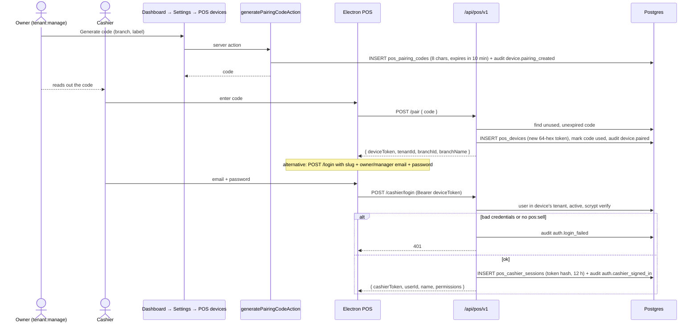
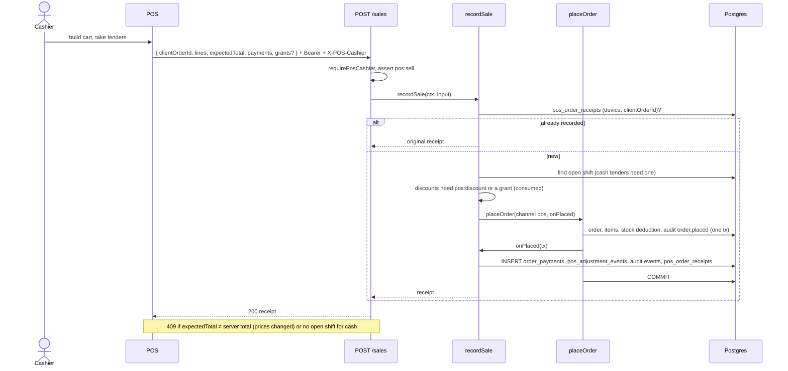
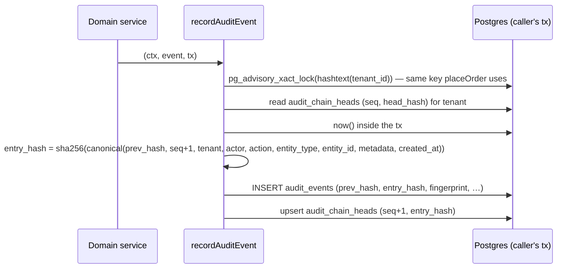

# Sequence Diagrams

End-to-end flows as the code runs them. Each diagram names the route or Server Action and the service function so you can follow it in the source.

## 1. Storefront order placement

`POST /api/orders` → `placeOrder` (`src/server/ordering/service.ts`).

```mermaid
sequenceDiagram
    actor Customer
    participant SF as Storefront
    participant API as POST /api/orders
    participant Svc as placeOrder
    participant DB as Postgres (withTenant tx)
    participant RT as Realtime

    Customer->>SF: Checkout
    SF->>API: { slug, branchId, fulfillmentType, lines, payment… }
    API->>API: resolve tenant by slug (active/trial only), customer from serveos_customer cookie
    API->>Svc: placeOrder(tenantId, input)
    Svc->>Svc: payment method check (offline methods → pending_verification)
    Svc->>DB: BEGIN; set_config('app.tenant_id')
    Svc->>DB: branch orderable? lines valid vs catalog (snapshots, modifiers, variants)
    Svc->>DB: delivery area / fee, totals (order-totals.ts)
    Svc->>DB: pg_advisory_xact_lock(hashtext(tenant_id)); order_number = max + 1
    Svc->>DB: INSERT orders, order_items, order_status_events (pending)
    alt inventory capability
        Svc->>DB: deductForOrderLine per line (FIFO lots, sale_deduction ledger rows)
        alt shortfall and negative stock not allowed
            DB-->>Svc: OutOfStockError → ROLLBACK
            Svc-->>API: DomainError
            API-->>SF: 422 { error, code }
        end
    end
    Svc->>DB: recordAuditEvent(order.placed)
    Svc->>DB: COMMIT
    Svc->>DB: incrementUsage(orders)
    Svc->>RT: publish orders.changed
    Svc-->>API: { orderId, orderNumber, statusToken, total, itemIds }
    API-->>SF: 201
```

## 2. POS pairing and cashier sign-in

Codes are minted by a **dashboard Server Action**, not an API route.



## 3. POS sale

`POST /api/pos/v1/sales` → `recordSale` (`src/server/pos/record-sale.ts`), which delegates the order itself to `placeOrder`.



## 4. Shift: open, movements, close

`src/server/pos/shifts.ts`, `cash-movements.ts`, `src/server/analytics/pos-reports.ts`.

```mermaid
sequenceDiagram
    actor Cashier
    participant POS
    participant API as /api/pos/v1
    participant DB as Postgres

    Cashier->>POS: opening float
    POS->>API: POST /shifts/open { openingFloat, denominations? }
    API->>DB: INSERT pos_shifts (open) + opening cash_counts row
    API-->>POS: { shift }

    Cashier->>POS: safe drop
    POS->>API: POST /shifts/movements { type: safe_drop, amount, reasonCode }
    API->>DB: INSERT cash_movements (pay-outs over threshold need reconciliation:manage or a grant)
    API-->>POS: { movement }

    POS->>API: GET /reports/x
    API->>DB: today's branch totals + expected drawer cash
    API-->>POS: X report

    Cashier->>POS: count drawer
    POS->>API: POST /shifts/close { count: { countedTotal, denominations? }, grants? }
    API->>API: expected = float + cash tenders − cash refunds + pay-ins − pay-outs − safe drops; variance = counted − expected
    API->>DB: INSERT closing cash_counts, UPDATE pos_shifts → closed, audit
    API-->>POS: { report } (Z report)
```

## 5. POS refund

`POST /api/pos/v1/sales/[id]/refund` → `issueRefund` (`src/server/pos/refund.ts`).

```mermaid
sequenceDiagram
    actor Cashier
    participant POS
    participant API as POST /sales/[id]/refund
    participant Svc as issueRefund
    participant DB as Postgres

    POS->>API: { clientRefundId, kind, lines[{…, restock}], payments, reasonCode, grantToken? }
    API->>API: requirePosCashier, assert pos:sell
    API->>Svc: issueRefund
    Svc->>Svc: resolveAuthorizer(pos:refund) — cashier's own permission or a manager grant, else 403
    Svc->>DB: BEGIN; lock order (FOR UPDATE); refuse cancelled/rejected/unpaid
    Svc->>DB: INSERT refunds, refund_lines, refund_payments
    Svc->>DB: restock lines with restock = true
    Svc->>DB: UPDATE orders.payment_status → refunded | partially_refunded
    Svc->>DB: COMMIT
    Svc-->>API: RefundResult
    API-->>POS: 200
```

Note: the restock step (`restockRefundedLines`) still increments the legacy `products.stock_quantity` / `product_variants.stock_quantity` counters, not inventory lots or a `refund_restock` ledger row; the code comment flags this as pending realignment with the inventory core.

## 6. Inventory deduction on sale

Inside `placeOrder`'s transaction, `deductForOrderLine` (`src/server/inventory/service.ts`).

```mermaid
sequenceDiagram
    participant PO as placeOrder
    participant Inv as deductForOrderLine
    participant DB as Postgres (same tx)

    PO->>Inv: per order line (product, variant, qty, orderItemId)
    Inv->>DB: product_inventory_links for product/variant
    alt no link
        Inv-->>PO: nothing to deduct
    else finished_good
        Inv->>DB: branch retail location (created if missing)
        Inv->>Inv: deductFifo(item, qty)
    else recipe
        Inv->>DB: branch kitchen location, recipe + components
        loop each component
            Inv->>Inv: deductFifo(item, component qty × sold qty)
        end
    end
    Note over Inv,DB: deductFifo: take unexpired lots ordered by expiry, then received_at;<br/>INSERT stock_ledger (sale_deduction) per lot used
    alt shortfall, negative not allowed
        Inv-->>PO: OutOfStockError (whole order rolls back)
    else shortfall, negative allowed
        Inv->>DB: ledger row with no lot + low_stock notification (owner, manager)
    end
```

## 7. Purchase order

Dashboard Server Actions or `/api/purchase-orders/*` → `src/server/purchasing/`.

```mermaid
sequenceDiagram
    actor Manager as Manager (purchasing:manage)
    participant App as ServeOS
    participant DB as Postgres
    participant Worker as Notifications worker (cron)
    participant Resend

    Manager->>App: create draft PO
    App->>DB: INSERT purchase_orders (draft), purchase_order_lines
    Manager->>App: send
    App->>DB: lock PO; INSERT notification_outbox (HTML PO to supplier email); notify owner/manager; status → sent
    Worker->>DB: drain outbox
    Worker->>Resend: send email
    Manager->>App: post receipt (received qty per line)
    App->>DB: INSERT po_receipts, po_receipt_lines; receiveStock → inventory_lots + receive ledger (valued at PO line cost)
    App->>DB: status → partially_received | received
    Manager->>App: enter invoice total
    App->>DB: store invoice total
    Manager->>App: view variance (ordered vs received vs invoiced)
    Manager->>App: close
    App->>DB: received → closed
```

## 8. Audit event append

`recordAuditEvent` (`src/server/audit/service.ts`), always called on the caller's `withTenant` transaction.



The fingerprint (IP, user agent, POS device id / token hash / app version) is stored on the row but is not part of the hash input.

## 9. WhatsApp ordering

`POST /api/whatsapp/webhook` → `ingestWebhook` → `handleInbound` (`src/server/whatsapp/`).

```mermaid
sequenceDiagram
    actor Customer
    participant Meta as WhatsApp Cloud API
    participant API as /api/whatsapp/webhook
    participant Ing as ingestWebhook
    participant Run as runner + reducer
    participant DB as Postgres
    participant SF as Storefront

    Customer->>Meta: message / button tap
    Meta->>API: POST (x-hub-signature-256)
    API->>Ing: raw body
    Ing->>Ing: verify HMAC; resolve whatsapp_accounts by phone number id
    Ing->>Ing: skip if tenant not servable or plan lacks the whatsapp feature
    Ing->>DB: record inbound whatsapp_messages (dedupe)
    Ing->>Run: handleInbound
    Run->>DB: whatsapp_conversations (reset to idle if older than 24 h)
    Run->>Run: reducer(state, message) → next state, replies, effects
    alt confirm → yes (pickup)
        Run->>DB: reserve whatsapp_order_receipts, placeOrder(channel whatsapp)
    else delivery, or product with required modifiers
        Run->>DB: INSERT cart_handoff_tokens (single use, 60 min)
        Run->>Meta: "Finish your order here: https://<slug>.<root>/?handoff=<token>"
        Customer->>SF: open link
        SF->>DB: redeemHandoff (scoped to the host's tenant) → cart prefilled
    end
    Run->>DB: save conversation state + cart
    Run->>Meta: send replies
    API-->>Meta: 200
```

## 10. Pharmacy prescription

```mermaid
sequenceDiagram
    actor Customer
    participant SF as Storefront
    participant Up as POST /api/prescriptions
    participant Store as Supabase Storage (private bucket)
    participant Ord as POST /api/orders → placeOrder
    participant DB as Postgres
    actor Pharm as Pharmacist (rx:review)
    participant Act as reviewPrescriptionAction

    Customer->>SF: upload prescription (signed in)
    SF->>Up: multipart file
    Up->>Store: upload to "prescriptions" bucket
    Up->>DB: INSERT prescriptions (pending, image path) + audit rx.submitted
    Up-->>SF: { id, status }
    Customer->>SF: checkout with prescription items
    SF->>Ord: order
    Ord->>DB: needs a pending, unattached prescription for this customer
    Ord->>DB: INSERT orders (status pending, rx_review_status pending); attach prescription
    Pharm->>Act: approve / reject (dashboard → prescriptions)
    Act->>DB: prescriptions.status and orders.rx_review_status → approved | rejected (one tx) + audit
    Note over DB: order status is unchanged; staff then confirm, reject or cancel it.<br/>While rx_review_status is pending only reject/cancel are allowed.
```
