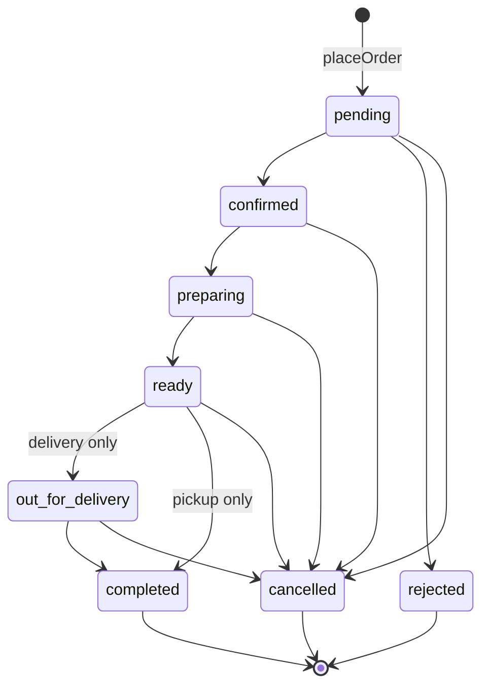
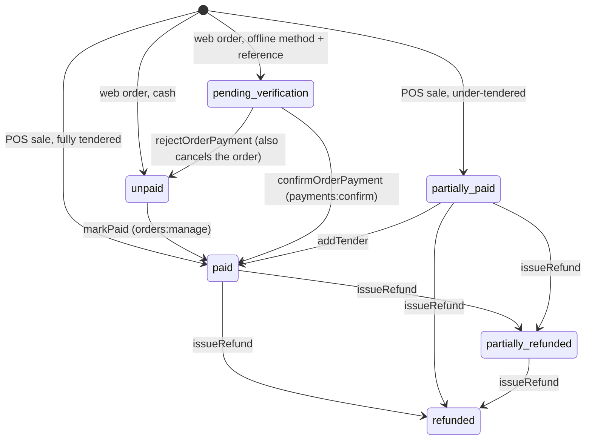
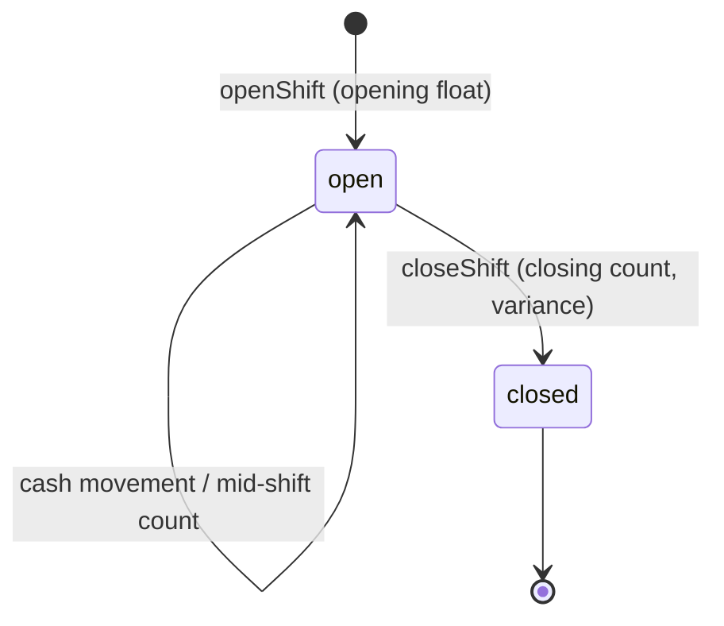
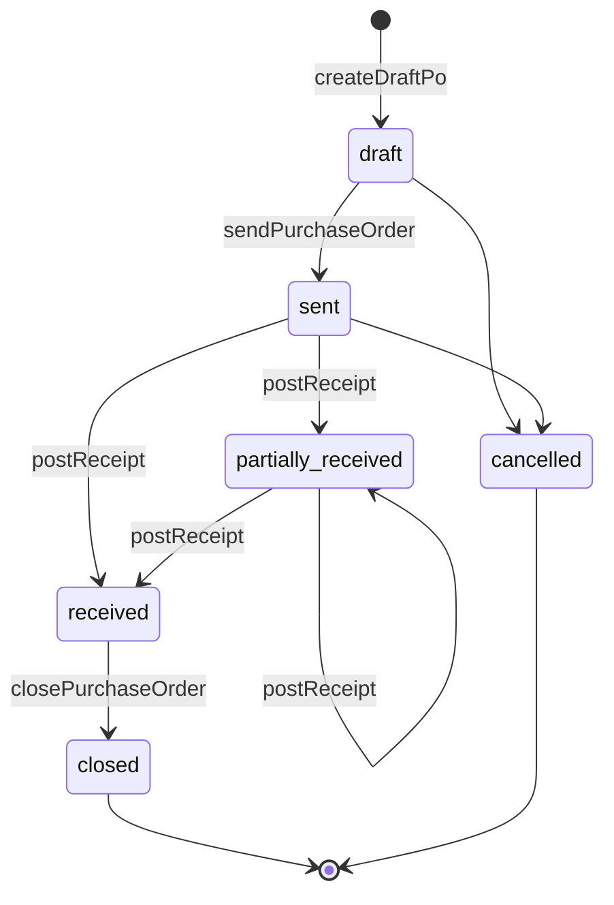
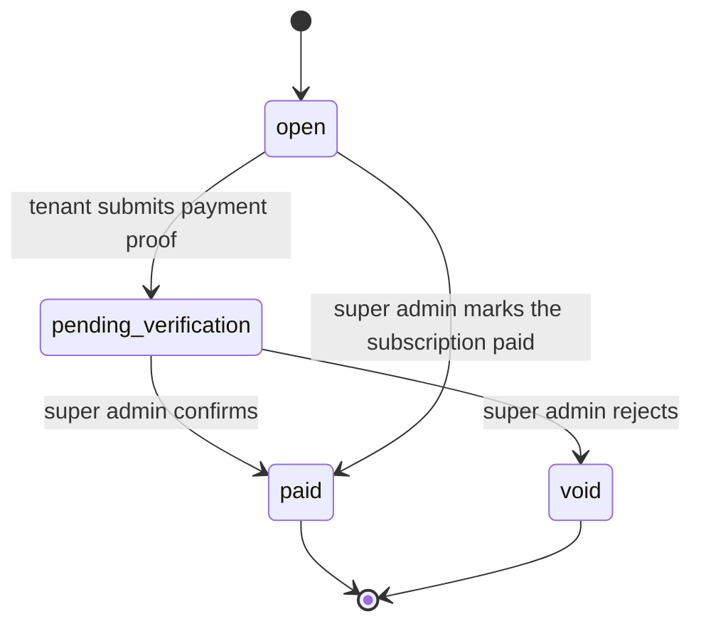
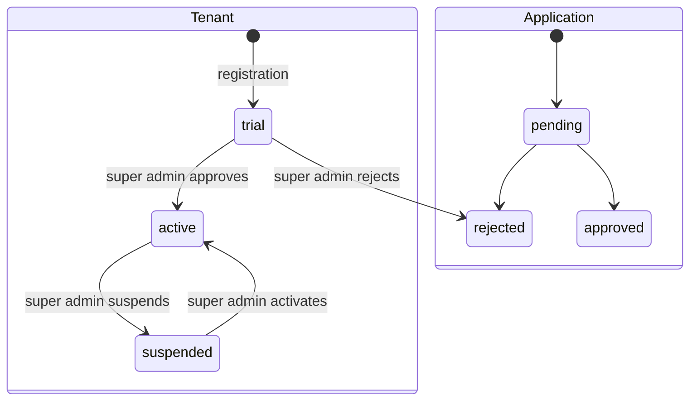
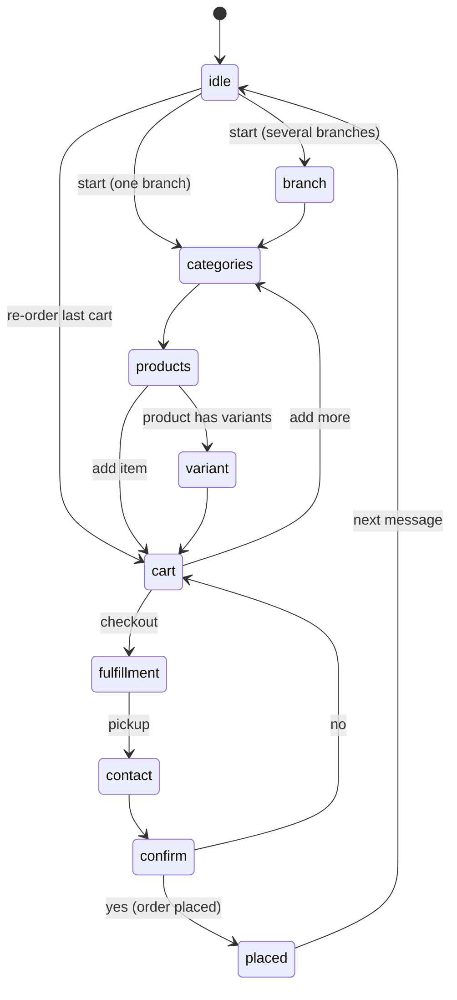
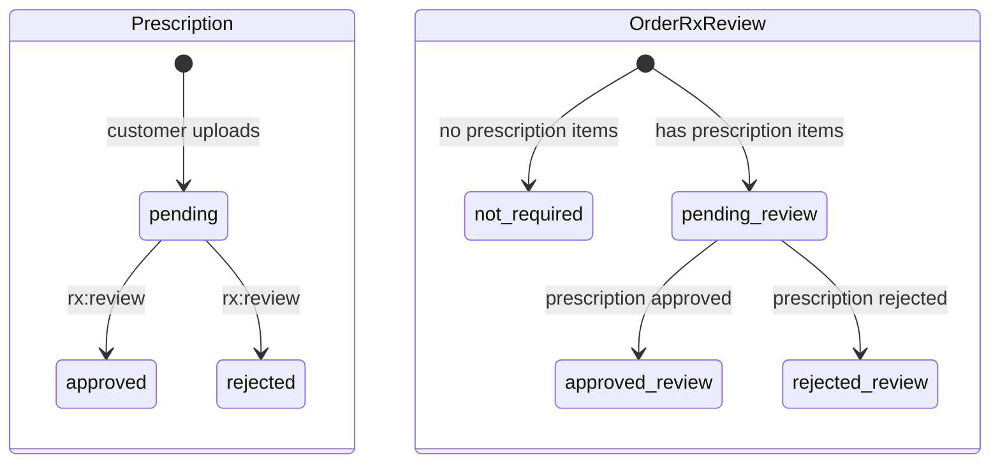

# State Machines

Every status enum in the schema, the transitions the code actually performs, and where each rule lives. Enum values come from the Drizzle schema ([tables.md § Enums](../database/tables.md#enums)).

## 1. Order status (`order_status`)

Source: `nextStatuses()` in `src/server/ordering/state-machine.ts`, enforced by `transitionStatus()` in `src/server/ordering/service.ts`.

| From | Allowed next |
|---|---|
| `pending` | `confirmed`, `rejected`, `cancelled` |
| `confirmed` | `preparing`, `cancelled` |
| `preparing` | `ready`, `cancelled` |
| `ready` | `out_for_delivery` (delivery) or `completed` (pickup), `cancelled` |
| `out_for_delivery` | `completed`, `cancelled` |
| `completed`, `rejected`, `cancelled` | terminal |

**Guards**
- `ready → out_for_delivery` only when `fulfillment_type = delivery`; `ready → completed` only for `pickup`.
- **Prescription gate:** while `rx_review_status = pending`, the only allowed moves are to `cancelled` or `rejected`.
- The UPDATE is guarded on the current status (`WHERE status = <expected>`), so two concurrent transitions cannot both win.
- Customer self-cancel (`POST /api/orders/[token]/cancel`, `cancelOrderByToken`) is only allowed while the order is still `pending`; staff cancels go through `transitionStatus` with the wider rights above.

**Side effects of `transitionStatus`** (same transaction unless noted)
- Inserts an `order_status_events` row and an `order.status_changed` audit event.
- On `cancelled` / `rejected`: restocks the order's items.
- For WhatsApp orders: queues a status message on `confirmed`, `ready` and `out_for_delivery` (`whatsapp_status_queue`).
- After commit: publishes `orders.changed` on the tenant's realtime topic.

## 2. Payment status (`payment_status`)

There is no single transition table; each writer sets the status it owns.

| Writer | Effect | File |
|---|---|---|
| `placeOrder` | `unpaid` for cash; `pending_verification` for InstaPay / Vodafone Cash / mobile wallet (requires a payment reference) | `src/server/ordering/service.ts` |
| `recordSale`, `addTender` | `paid` if tenders cover the total, else `partially_paid` | `src/server/pos/record-sale.ts` |
| `markPaid` | → `paid`; refused for cancelled/rejected orders and for `pending_verification` | `src/server/ordering/service.ts` |
| `confirmOrderPayment` | `pending_verification` → `paid` | same |
| `rejectOrderPayment` | `pending_verification` → `unpaid`, then cancels the order | same |
| `issueRefund` | → `refunded` when net paid reaches zero, else `partially_refunded`; refused for unpaid / pending / cancelled / rejected orders | `src/server/pos/refund.ts` |

## 3. POS shift (`pos_shift_status`)

- At most one open shift per device: partial unique index `pos_shifts_device_open` on `device_id WHERE status = 'open'`.
- Expected cash = opening float + cash tenders − cash refunds + pay-ins − pay-outs − safe drops (`computeExpectedCash`, `src/server/pos/shift-math.ts`); variance = counted − expected.
- Closing another cashier's drawer, or settling a variance above the tenant's threshold, needs `reconciliation:manage` or a manager grant.
- Cash counts (`cash_count_kind`): `opening`, `mid_shift`, `closing`. Movements (`cash_movement_type`): `pay_in`, `pay_out`, `safe_drop`, `no_sale`.

## 4. Purchase order lifecycle (`po_status`)

Source: `PO_TRANSITIONS` in `src/server/purchasing/status.ts`.

- `partially_received` cannot be closed or cancelled; only `received` can be closed.
- Re-sending a `sent` PO is allowed (no transition).
- The receipt status is derived from the lines: all lines met → `received`, some received → `partially_received`.
- Side effects: send queues the supplier email in `notification_outbox` and notifies owners/managers; each receipt creates `po_receipts` / `po_receipt_lines`, inventory lots and `receive` ledger rows.
- An invoice total can be entered on `sent`, `partially_received` or `received` POs.

## 5. Subscription invoice (`invoice_status`)

Source: `src/server/billing/service.ts`, `src/server/platform/service.ts`.

Confirming (or marking paid) activates the tenant's subscription on the invoice's plan.

## 6. Subscription (`subscription_status`)

`src/server/subscription/service.ts` defines an allowed-transition map and a `transition()` function that enforces it:

| From | Allowed next |
|---|---|
| `trialing` | `active`, `past_due`, `canceled` |
| `active` | `past_due`, `canceled` |
| `past_due` | `active`, `suspended`, `canceled` |
| `suspended` | `active`, `canceled` |
| `canceled` | — |

What the running code actually does today:
- Registration creates the subscription as `trialing` with a 14-day `trial_ends_at`.
- `activateSubscriptionForPlan` (invoice confirmed / marked paid) and the admin "force active" action set `active` directly.
- The admin "cancel subscription" action sets `canceled` directly.
- Nothing calls `transition()` outside tests, and nothing sets `past_due` or `suspended` automatically (there is no trial-expiry or dunning job).

## 7. Tenant and onboarding application (`tenant_status`, `application_status`)

- Registration (`src/server/onboarding/service.ts`) creates the tenant with status `trial`, its owner, roles, a `trialing` subscription and a `pending` onboarding application. The column default is `onboarding`, but the registration path does not use it.
- Approve/reject update the tenant and the application together (`src/server/platform/service.ts`).
- Storefront routes serve only `active` and `trial` tenants (`isTenantServable`).

## 8. WhatsApp conversation (`whatsapp_conversation_state`)

Source: `src/server/whatsapp/reducer.ts` (pure reducer) and `runner.ts`.

- **Handoff to the storefront** (state unchanged, a single-use link is sent): choosing **delivery** at `fulfillment`, or a product with **required modifiers** at `products`.
- **Reset to `idle`** (cart cleared): cancel or restart words from any state, and any conversation idle longer than the 24-hour TTL.
- Taps on a superseded message are rejected by a per-conversation version stamp.

## 9. Prescriptions (`prescription_status`, `rx_review_status`)

(`pending_review` / `approved_review` / `rejected_review` are the `pending` / `approved` / `rejected` values of `rx_review_status`, renamed only so the diagram's two states don't collide.)

- An order with any `requires_prescription` product needs a signed-in customer with a pending, unattached prescription; `placeOrder` attaches it to the order and sets `rx_review_status = pending`.
- `reviewPrescription` sets the prescription status and the order's `rx_review_status` in one transaction. It does **not** change the order status; staff then confirm, reject or cancel the order.
- While `rx_review_status = pending` the order can only be rejected or cancelled (§1).

## 10. Other status enums

| Enum | Values | Notes |
|---|---|---|
| `stock_count_status` | `open`, `committed`, `cancelled` | open → committed via `POST /api/inventory/counts/[id]/commit`; committing twice is rejected |
| `outbox_status` | `queued`, `sending`, `sent`, `failed` | email outbox drained by the notifications worker |
| `whatsapp_status_queue_status` | `queued`, `sent`, `skipped`, `failed` | WhatsApp order-status messages |
| `customer_status` | `active`, `disabled` | |
| `whatsapp_account_status` | `active`, `disconnected`, `suspended` | |
